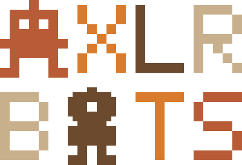

## Underpass AI

**Memory, coordination, and execution infrastructure for reliable AI agents.**

Website: [underpassai.com](https://underpassai.com)

Underpass AI builds the infrastructure around models: a memory plane that
agents can navigate and audit, a coordination plane for durable procedures
involving agents and people, and an execution plane that governs how agents
act on real systems. On top of the three planes, AXLR Bots runs persistent,
governed bots on your own hosts.

We do not build foundation models. We build the operational substrate that
makes them safer, more useful, and easier to inspect in production.

| Memory | Coordination | Execution | Bots |
| :---: | :---: | :---: | :---: |
| [<picture><source media="(prefers-color-scheme: dark)" srcset="assets/kmp-emblem-dark.svg"></picture>](https://github.com/underpass-ai/kmp) | [<picture><source media="(prefers-color-scheme: dark)" srcset="assets/made-emblem-dark.svg"></picture>](https://github.com/underpass-ai/made) | [<picture><source media="(prefers-color-scheme: dark)" srcset="assets/axlr-emblem-dark.svg"></picture>](https://github.com/underpass-ai/AXLR) | [](https://github.com/underpass-ai/axlr-bots) |

### What We Build

**Memory plane — [KMP by Underpass](https://github.com/underpass-ai/kmp)**
gives Codex, Claude Code and Hermes Agent local-first memory. It stores decisions
and evidence in SQLite, with explicit clocks and relations that preserve what
changed, why it changed and what proves it. Agents recover scoped context, ask
for stored evidence, navigate history and audit the original sources. `UNKNOWN`
is an explicit outcome when the selected memory cannot answer.

**ChronoLoom** gives the person and the agent a shared view of that memory:
timelines, about layers, filters and proof paths. The person can take control
or undo a view move. A progressive guide teaches the agent how to use the live
MCP tools.

- **Local / embedded — the default.** The kernel runs inside the MCP process,
  with no database server, KMP account or hosted service required. Multiple local
  hosts can share SQLite memory. Native plugins support Codex and Claude Code;
  native setup supports Hermes. Reviewed portable bundles carry project memory
  between machines.
- **Shared service — optional and self-operated.** Typed gRPC APIs backed by
  Neo4j, Valkey and NATS JetStream, with Helm/Kubernetes deployment, TLS/mTLS and
  observability. Operators own the infrastructure, identity and authorization.
  Backend-specific capabilities are documented rather than assumed identical.

Default embedded retrieval needs no external model. Optional TypeSafe Jev
features send selected text to an external service for judgments; an optional
semantic encoder runs locally. Evidence returned to a cloud agent also follows
that host's data policy. Your agent writes the final answer from the evidence.

[Install KMP](https://github.com/underpass-ai/kmp#install)
· [Embedded memory](https://github.com/underpass-ai/kmp/blob/main/docs/embedded/README.md)
· [Explore ChronoLoom](https://github.com/underpass-ai/kmp/tree/main/crates/kmp-viewer)

**Coordination plane — [MADE](https://github.com/underpass-ai/made)**
(Multi-Agent Deliberation Engine) coordinates shared procedures: who can act,
which work is ready, what needs review and when a person must decide. The host
supplies agents, tools and people. MADE validates their progress and records
accepted results in an auditable ceremony event stream.

- **Local / embedded — the default.** Plugins for Codex and Claude Code run
  through MCP and SQLite. Setup configures the store, authorization and a
  persistent search cursor key. No MADE account, deployed service or Kubernetes
  is required. Rust applications can embed the same engine. Publish definitions
  before starting ceremonies that must resume after restart.
- **Durable work and human review.** YAML ceremonies declare roles, sequential
  or concurrent steps, human guards, retries and deadlines. Eight coordination
  shapes ship as patterns, from maker and checker to an advisor that reviews
  each pass of an executor. Hosts claim work, perform it and return results
  tied to the accepted claim; a claimed step alone performs no external work.
- **Systems and supervision.** Compose published ceremonies into one
  system, hand a paused ceremony to an auditable successor, and send questions
  to working agents with tracked acknowledgements. An integrator host follows
  results, blockers and human decisions through a durable attention loop.
  The host still supplies execution; automatic host activation is opt-in.
- **Shared service — optional and self-operated.** gRPC, PostgreSQL, NATS and
  Helm/Kubernetes support shared deployments. Configured provider-backed
  councils can propose, critique, revise, validate and score contributions,
  with output contracts, an optional LLM judge, metrics and traces.

[Install MADE](https://github.com/underpass-ai/made/blob/main/docs/plugins/README.md)
· [Manual MCP setup](https://github.com/underpass-ai/made/blob/main/docs/embedded/README.md)
· [Workflow contracts and limits](https://github.com/underpass-ai/made/blob/main/docs/corte7/README.md)
· [Rust embedding](https://github.com/underpass-ai/made/blob/main/docs/embedded/rust.md)

**Execution plane — [AXLR](https://github.com/underpass-ai/AXLR)** runs the
agent's model loop, tools, approvals and sessions in a trusted workspace: file
tools stay inside the selected root, while programs and MCP servers act with
the host's authority. Models come through OpenRouter, local OpenAI-compatible
servers, or native adapters for the Anthropic Messages and OpenAI Responses
APIs. With both engines connected, each session carries its KMP context and
its own MADE instance. When no tool fits, the model can forge one, and `/tools`
installs tested, pre-forged tools from a signed catalog.

- **Local — the console and one command.** `axlr-tui` streams the agent's work,
  saves sessions and asks before tool calls. `axlr-tui --exec` runs one
  execution without a screen: JSON events, a result object with the status,
  answer, tool calls and usage, and an exit code a script can branch on. A
  pending call is decided later from the command line. A JSON worker and a Go
  library serve other hosts.
- **Governed executions.** An execution can carry a policy, a budget and
  correlation ids. The policy sets an autonomy level (observe, propose,
  act-with-approval or act-within-policy) and allow and deny rules over tools
  and their arguments. The budget limits seconds, requests, tool calls and
  dollars. The ids follow every event, trace and MADE record.
- **Service — optional and self-operated.** `axlr-serve` exposes the same loop
  over HTTP, gRPC and MCP behind mutual TLS. Each client certificate maps to a
  principal with roles: session client, approver, tool operator or admin. A
  Helm chart deploys it.

[Install AXLR](https://github.com/underpass-ai/AXLR/blob/main/docs/getting-started.md)
· [Runtime contract](https://github.com/underpass-ai/AXLR/blob/main/docs/runtime-contract.md)
· [axlr.underpassai.com](https://axlr.underpassai.com)

**Bots — [AXLR Bots](https://github.com/underpass-ai/axlr-bots)** runs
persistent, governed bots as infrastructure on your own hosts: one control
plane, any number of hosts, several bots per host. A bot is a declared resource
with a mission, a model, tools, an autonomy level, triggers, budgets and a
placement; it exists without running anything. When a task arrives, by hand,
from a webhook or on a timer, the control plane starts an execution on the
bot's host, and AXLR runs it under the bot's policy.

- **Control plane.** `axlr-bots` keeps the bots, tasks, executions, nodes and
  timers. It serves the CLI, the nodes and an operator API, fires the timers and
  reconciles what a crash left running.
- **Node agents.** `axlr-node` runs on every host that runs bots. It enrolls,
  heartbeats, polls for the executions of its bots, runs each one with AXLR and
  reports the result. Both commands install at user level under systemd,
  without root.

[Install AXLR Bots](https://github.com/underpass-ai/axlr-bots/blob/main/docs/runbooks/install.md)
· [Bot definition](https://github.com/underpass-ai/axlr-bots/blob/main/docs/reference/bot-definition.md)
· [Control plane, node and AXLR](https://github.com/underpass-ai/axlr-bots/blob/main/docs/architecture/control-plane-node-axlr.md)

Together, the three planes and the bots that run on them form
**infrastructure, not an application**. Any domain that needs institutional
memory plus governed action can be built on top.

### How It Works

A host can combine the three planes around a task or a domain event. KMP
recovers relevant memory, MADE coordinates the procedure, and AXLR runs the
agent's model turns and tools. AXLR's setup assistant installs and connects KMP
and MADE; installing KMP or MADE on its own connects nothing else.

```text
Task or domain event
  -> Host recovers scoped memory from KMP
    -> Host starts a published MADE ceremony; agents claim work, people decide at human guards
      -> AXLR runs agent turns and approved tools
        -> MADE records accepted results; host preserves evidence in KMP
          -> The next task starts with that memory
```

The common pattern:

```text
domain event -> orchestration -> agent -> memory -> governed action -> evidence -> better memory
```

With AXLR Bots, a bot reacts to an event as a service on its own host:

```text
webhook or timer -> control plane creates a task -> node agent runs it with AXLR under the bot's policy -> report and events
```

### Why It Matters

Reliable agents need memory they can navigate, not just context they can retrieve.

For real agentic work, it is not enough to ask which text chunk looks similar.
The system also needs to answer:

- what was known at a given moment;
- which attempt failed;
- what changed later;
- which agent introduced a wrong assumption;
- why one answer replaced another;
- which evidence supports the final result.

KMP by Underpass is built around that model: memory as a temporal, inspectable,
multidimensional graph, not just raw transcript replay or vector search over
chunks.

### Repositories

| Plane | Repository | Language | What it provides |
| --- | --- | --- | --- |
| **Memory** | [`kmp`](https://github.com/underpass-ai/kmp) | Rust | KMP by Underpass: local-first agent memory and the ChronoLoom viewer |
| **Coordination** | [`made`](https://github.com/underpass-ai/made) | Rust | MADE: durable procedures for agents and people |
| **Execution** | [`AXLR`](https://github.com/underpass-ai/AXLR) | Go | AXLR: the agent runtime for consoles, scripts and services |
| **Bots** | [`axlr-bots`](https://github.com/underpass-ai/axlr-bots) | Go | AXLR Bots: persistent, governed bots on your own hosts |

KMP's gRPC wire package keeps its historical name,
`underpass.rehydration.kernel.v1beta1`. The public memory product name is
**KMP by Underpass**.

### Architecture: What We Own

| Component | Ownership | Examples |
| --- | --- | --- |
| **KMP by Underpass** | Underpass | Memory protocol, temporal traversal, graph inspection, evidence model, embedded distribution |
| **MADE** | Underpass | Durable ceremonies, human guards, system composition, delivery and attention protocols, council deliberation |
| **AXLR** | Underpass | Agent loop, tool execution and approvals, execution policy and budget, runtime contract, service API, MCP and plugin integration |
| **AXLR Bots** | Underpass | Bot control plane, node agents and node protocol, enrollment and revocation, triggers, operator API |
| **Integration adapter** | Product/team using Underpass | Alert relay, CI/CD hooks, ERP connectors, domain event emitters |
| **Application services** | Product/team using Underpass | payments-api, order-svc, internal platforms |
| **Observability and CI/CD** | Product/team using Underpass | Prometheus, Grafana, PagerDuty, GitHub Actions, ArgoCD |

### Production-Oriented Foundations

- **KMP — evidence before claims.** Recovered memory carries refs and proof
  that `kmp_trace` and `kmp_inspect` audit. Decisions are superseded, never
  quietly rewritten. Temporal reads page with a cursor and never present a
  partial page as a complete interval. An invalid backend combination fails
  instead of silently opening another store, and a store in an unsupported
  format is rejected untouched.
- **MADE — a journal that verifies itself.** Every accepted result is a record
  that carries the hash of the record before it, and
  `made_verify_ceremony_journal` checks the chain. Authorization is explicit per
  action and scope. A result must carry its claim's fence: a foreign fence is
  refused without an append, and a late one cannot change the outcome.
- **AXLR — a tool call never runs on the model's say-so.** The execution's
  policy, the run's approval level, the settings, the work mode and the list of
  destructive commands decide. A call the policy forbids is refused outside the
  model, before any approval card. On the service, an mTLS certificate never
  approves a tool by itself; turns, decisions and direct calls are idempotent
  on their key, and revisions guard decisions.
- **AXLR Bots — outbound connections, nothing created twice.** A node joins
  with a one-time token and then connects outward over mutual TLS; the control
  plane never reaches into a host. Submissions carry a key, webhook fires derive
  theirs from the delivery and timers from the slot, so a retry, a redelivery or
  a restart creates nothing twice.

### Currently Building

**KMP** — on `main` and not yet released: a fresh store receives its guide on
the first guide read, so installing is install, setup and one restart.
`kmp-mcp demo` writes a worked example into the local store and opens
ChronoLoom on it, and `examples/` holds real memories to load and ask about.
See the [Unreleased changes](https://github.com/underpass-ai/kmp/blob/main/CHANGELOG.md#unreleased).

**MADE** — on `main` and not yet released: a person approves a human guard and
issues grants from their own terminal, where the agent's session cannot do it
for them. Tool profiles cut what a host loads, and signed evidence bundles let
someone without the store verify a ceremony's journal. See the
[Unreleased changes](https://github.com/underpass-ai/made/blob/main/CHANGELOG.md#unreleased).

**AXLR** — next in the runtime contract: the artifacts an execution delivers,
such as a report, a diff or a file, listed in its result. The
[master plan](https://github.com/underpass-ai/AXLR/blob/main/docs/plans/2026-10-23-master-plan.md)
also names approvals that reach a person and expire, and an execution receipt
with every action and what it cost.

**AXLR Bots** — next: the node agent as a sidecar beside a service in a pod,
the budget each execution was given stored with it, and a real database in
place of one JSON file per aggregate. The architecture page says
[what is next and what is left out](https://github.com/underpass-ai/axlr-bots/blob/main/docs/architecture/control-plane-node-axlr.md#what-is-next).

### Articles

- [I let my GPU workers shut themselves down after five minutes](https://underpassai.com/articles/disposable-compute-persistent-evidence/)
- [No queremos agentes que contesten. Queremos decisiones que se puedan auditar](https://dev.to/tirsogarcia/no-queremos-agentes-que-contesten-queremos-decisiones-que-se-puedan-auditar-11gm)
- [Operator: cuando responder no basta](https://dev.to/tirsogarcia/operator-cuando-responder-no-basta-2kna)
- [Building Kernel Memory Protocol: Navigable Memory for AI Agents](https://dev.to/tirsogarcia/building-kernel-memory-protocol-navigable-memory-for-ai-agents-315j)
- [Construyendo Kernel Memory Protocol: memoria navegable para agentes de IA](https://dev.to/tirsogarcia/construyendo-kernel-memory-protocol-memoria-navegable-para-agentes-de-ia-24lc)
- [What an event-driven agent pipeline looks like when you trace it end-to-end](https://dev.to/tirsogarcia/what-an-event-driven-agent-pipeline-looks-like-when-you-trace-it-end-to-end-1cck)
- [Why event-driven agents reduce scope, cost, and decision dispersion](https://dev.to/tirsogarcia/why-event-driven-agents-reduce-scope-cost-and-decision-dispersion-2062)

### Status

**KMP** [v0.25.0](https://github.com/underpass-ai/kmp/releases/tag/v0.25.0) is
the latest release, and KMP is pre-1.0. Release automation builds `kmp-mcp`
for Linux x86_64/arm64, macOS arm64/x86_64 and Windows x86_64. The optional
remote API is versioned `v1beta1` and expects an operator.

**MADE** [v0.10.0](https://github.com/underpass-ai/made/releases/tag/v0.10.0)
is the latest release, and MADE is pre-1.0. The release carries checksummed
`made-mcp` binaries and plugin bundles. Upgrades from older releases can
require client and store changes; follow the
[migration guide](https://github.com/underpass-ai/made/blob/main/docs/migrations/README.md).

**AXLR** [v0.14.0](https://github.com/underpass-ai/AXLR/releases/tag/v0.14.0)
was released on 24 October 2026, and AXLR is pre-1.0. Each release ships
native archives for Linux, macOS and Windows on amd64 and arm64. The service
configures KMP and MADE only and does not expose the console's plugin
installation or work modes.

**AXLR Bots** is public and pre-1.0, with no release yet: it builds from
source and runs on Linux. What works today has been exercised live on one host
with the real AXLR.

KMP, MADE, AXLR and AXLR Bots are released under Apache-2.0. For any other
public repository, its own LICENSE file, where present, states the terms.

### Ownership

Underpass AI is a project created by
[Tirso García Ibáñez](https://github.com/tgarciai).

### Contact

[LinkedIn](https://www.linkedin.com/in/tirsogarcia/) ·
[GitHub](https://github.com/tgarciai)

- tgarciai@underpassai.com
- contact@underpassai.com
